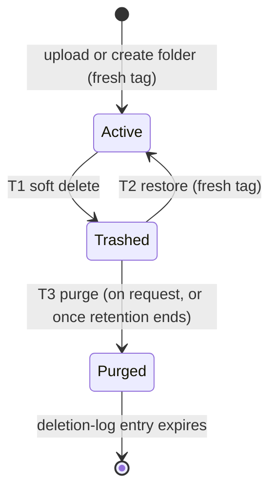

# Solid.Drive Soft Delete and Catalog Data Model

**Version:** 0.9.0

**Status:** Draft for review. Complete, but not yet stable: terms and rules may change before version 1.0.0 (Section 2).

**Date:** 2026-11-18

**Editors:** Andreas Both, Parnian Hajian (to be confirmed in review)

**Latest version:** <https://github.com/WSE-research/Solid.Drive/blob/main/docs/spec/soft-delete.md>

**Defines:** the trash vocabulary <https://purl.org/solid-drive/trash#> ([trash.ttl](trash.ttl)) and the shapes <https://purl.org/solid-drive/shapes#> ([shapes.ttl](shapes.ttl)). Reuses the catalog vocabulary <https://purl.org/solid-drive/catalog#> ([public/vocab/solid-drive-catalog.ttl](../../public/vocab/solid-drive-catalog.ttl), version 1.2.0) unchanged.

**Implementations described:** Solid.Drive, main at commit `c8c4e7c` (after pull requests #187 and #188); Solid.Sync at commit `fb4a118` (release 2.1.2 plus one fix), as far as it reads and writes the same documents.

**License:** the vocabulary, the shapes, and this text are published under [CC BY 4.0](https://creativecommons.org/licenses/by/4.0/), like the catalog vocabulary.

## Abstract

The Solid Protocol offers only an irreversible delete. This specification defines how a Solid Pod keeps the deleted state of files and folders as Linked Data, so that every client that uses the Pod can recognize a deleted item, check it, restore it, and purge it. It specifies four kinds of documents (the resource description of a file, the catalog and its rows, the tombstone of a trash entry, and the deletion log), SHACL shapes for them, a lifecycle from active through trashed to restored or purged, and invariants that every client must keep so that a deletion never loses content and a stale write cannot undo it, using nothing but the Solid Protocol. Established vocabularies carry almost everything; four terms are defined here.

## Contents

1. [Introduction](#1-introduction)
2. [Versioning and citation](#2-versioning-and-citation)
3. [Conformance](#3-conformance)
4. [Terminology](#4-terminology)
5. [Documents](#5-documents)
6. [Vocabulary](#6-vocabulary)
7. [Lifecycle](#7-lifecycle)
8. [Invariants](#8-invariants)
9. [Namespace migration](#9-namespace-migration)
10. [Checking a document](#10-checking-a-document)
11. [Known gaps](#11-known-gaps)
12. [Open questions](#12-open-questions)
13. [Change log](#13-change-log)
14. [References](#14-references)

## 1. Introduction

Solid.Drive is a Web file manager that runs entirely in the browser and keeps files in a Solid Pod. When a user deletes a file or folder, Solid.Drive moves it into a trash in the same Pod instead of deleting it, so that it can be restored until its retention period ends. Solid.Sync, a synchronization client built separately, reads and writes the same documents on the same Pod. The two clients never talk to each other: they meet only in these documents, so the documents and the rules for changing them are the contract between them. This specification writes that contract down so that a third client can join, and so that the shapes can check what any client writes.

The model goes back to the soft-deletion design of Parnian Hajian's thesis [HAJIAN], which Solid.Drive implements. The contract that Solid.Sync relies on is listed in its repository as `SOLID_DRIVE_CONTRACT.md` [SYNC-CONTRACT]; this specification covers the same documents and states what that list leaves implicit.

In scope: the layout of the documents in the Pod (Section 5), what each document says and in which terms (Sections 5 and 6), the transitions between active, trashed, restored, and purged (Section 7), the rules every client keeps when it changes these documents (Section 8), and the migration of the trash terms to a namespace that resolves (Section 9).

Out of scope: how a client presents the trash, how it discovers the storage root and the owner's WebID, sharing between users (Solid.Drive's per-contact shared catalogs), and Access Control Policies (ACP). Only Web Access Control (WAC) [WAC] is covered.

Sections 11 and 12 are informative: they list where the two implementations do not yet meet this specification, and the decisions this version leaves to the maintainers.

## 2. Versioning and citation

This specification, its vocabulary, and its shapes carry one version number, following Semantic Versioning 2.0.0 [SEMVER]. The vocabulary states it as `owl:versionInfo` with the version IRI `https://purl.org/solid-drive/trash/<version>`, and the shapes as `owl:versionInfo` with `https://purl.org/solid-drive/shapes/<version>`. A test (Section 10) fails if the three disagree. The term IRIs themselves never carry a version.

Rules for changing the version:

- Before 1.0.0, a minor version (0.10.0, 0.11.0, ...) may change or remove terms and MUST-level rules. Every such change is listed in the change log (Section 13).
- From 1.0.0 on, a major version is needed for an incompatible change: removing or redefining a term, or a new MUST-level rule that documents conforming to the previous version would violate. A minor version adds compatible things, such as an optional term or a SHOULD-level rule. A patch version fixes wording and examples only.

This version is 0.9.0 and not 1.0.0-draft, for three reasons. First, a 1.0.0 would promise a stable contract, but two decisions that change terms are still open (Section 12: the property for the former location, and a content digest). Second, neither client writes the specified trash namespace yet, and Solid.Drive's own `index.ttl` does not conform (Section 11, KG4), so a 1.0.0 would describe a contract that no client meets. Third, a 0.x version can take further reviewed drafts (0.9.1, 0.10.0) in a plain order, whereas a pre-release label such as `1.0.0-draft` announces that the content of 1.0.0 is already fixed. The version becomes 1.0.0 when the review is done, the open questions of Section 12 are decided, both clients read both trash namespaces (Section 9), the `https://purl.org/solid-drive/trash` PURL resolves, and the gaps KG4 and KG5 are fixed or the rules revised.

Cite a released version, not the main branch. Each release of the repository receives a DOI from Zenodo; until then the DOI below is a placeholder.

```bibtex
@techreport{soliddrive-softdelete-spec,
  author      = {Both, Andreas and Hajian, Parnian},
  title       = {Solid.Drive Soft Delete and Catalog Data Model, Version 0.9.0},
  institution = {WSE Research, HTWK Leipzig},
  type        = {Specification},
  year        = {2026},
  url         = {https://github.com/WSE-research/Solid.Drive/blob/main/docs/spec/soft-delete.md},
  doi         = {10.5281/zenodo.TBD}
}
```

## 3. Conformance

The key words MUST, MUST NOT, REQUIRED, SHALL, SHALL NOT, SHOULD, SHOULD NOT, RECOMMENDED, NOT RECOMMENDED, MAY, and OPTIONAL in this document are to be interpreted as described in BCP 14 [RFC2119] [RFC8174] when, and only when, they appear in all capitals, as shown here. Notes, examples, and Sections 11 and 12 are informative; everything else is normative.

There are three conformance classes:

- A **document** conforms if checking it in its role, as Section 10 describes, reports no result of severity `sh:Violation` and breaks none of the rules checked in code. Results of severity `sh:Warning` mark a SHOULD that the document does not meet.
- A **writer** is a client that changes any of the documents. A conforming writer writes only conforming documents, follows the layout of Section 5, makes only the transitions of Section 7, and keeps the invariants I1 to I11 of Section 8.
- A **reader** is a client that reads them. A conforming reader keeps the rules R1 to R5 of Section 8 and the reading rules of Section 9.

## 4. Terminology

- **Pod, storage root**: a Solid Pod, and its top container: the container typed `pim:Storage`, which the owner's WebID profile names with `pim:storage`.
- **Owner**: an agent that the access rule of the storage root grants `acl:Control`.
- **Client**: an application that reads or writes the Pod on behalf of a user, such as Solid.Drive or Solid.Sync.
- **Item**: a file or a folder.
- **File container, binary**: a file is stored in a container of its own (the file container), which holds the file's content (the binary) and its resource description.
- **Resource description**: the document `index.ttl` in a file container, which describes the file (Section 5.1).
- **Catalog, row**: a DCAT catalog document that lists items; each item it lists is one row, identified by an IRI (Section 5.2). A Pod has a main catalog and a trash catalog; a trashed folder keeps a catalog snapshot.
- **Tag**: a UUID that a row receives when it is added and keeps until it is removed (`sd:tag`). It tells a new row from a stale re-addition of a removed one.
- **Deletion log**: the document next to a catalog that records the tag of each removed row with the time of removal (Section 5.4).
- **Trash, trash entry, entry ID**: the container `trash/` at the storage root; one container `trash/<id>/` per trashed item, where the entry ID is a fresh UUID.
- **Payload**: the copy of the trashed content in a trash entry: the binary for a file (`payload`), the copied subtree for a folder (`payload/`).
- **Tombstone**: the document `tombstone.ttl` in a trash entry, which says what was deleted, from where, when, and until when it is kept (Section 5.3).
- **Access-rule snapshot**: `acl-snapshot.ttl`, a byte copy of the access-control document that the trashed item had of its own.
- **Retention period**: how long a trash entry is kept before it may be purged; Solid.Drive uses 30 days.
- **Shared document**: a document that more than one client changes: a catalog, the trash catalog, a deletion log.
- **Validator**: an `ETag` or `Last-Modified` value that a server sends with a representation [RFC9110]. An entity tag is weak if it starts with `W/`, otherwise strong.

## 5. Documents

### 5.0 Layout on the Pod

URLs are relative to the storage root. `<parent>` is a container, `<name>` an item name, and `<id>` an entry ID.

| Resource | URL | Written by | Role in Section 10 |
|---|---|---|---|
| File container | `<parent><slug>/` | upload | (none) |
| Binary | `<parent><slug>/<name>`, the name percent-encoded once | upload | (none) |
| Resource description | `<parent><slug>/index.ttl` | upload | `resource-description` |
| Folder | `<parent><slug>/` | create folder | (described by its row) |
| Main catalog | the object of `dcat:catalog` in the owner's profile, else `catalog.ttl` | every change | `catalog` |
| Deletion log of a catalog | `catalog-tombstones.ttl` in the catalog's container | every removal of a row | `deletion-log` |
| Trash | `trash/` | soft delete | (none) |
| Access rule of the trash | announced by the trash's `Link: <...>; rel="acl"` header, `trash/.acl` on most servers | see I6 | (WAC, not checked here) |
| Trash catalog | `trash/catalog.ttl` | soft delete, restore, purge | `catalog` |
| Deletion log of the trash catalog | `trash/catalog-tombstones.ttl` | restore, purge | `deletion-log` |
| Trash entry | `trash/<id>/` | soft delete | (none) |
| Payload of a file | `trash/<id>/payload` | soft delete | (none) |
| Copy of the resource description | `trash/<id>/index.ttl` | soft delete | `resource-description` |
| Payload of a folder | `trash/<id>/payload/`, mirroring the folder's subtree | soft delete | (none; its `index.ttl` files are `resource-description`) |
| Catalog snapshot of a folder | `trash/<id>/catalog-snapshot.ttl` | soft delete | `catalog` |
| Tombstone | `trash/<id>/tombstone.ttl` | soft delete | `tombstone` |
| Access-rule snapshot | `trash/<id>/acl-snapshot.ttl`, only if the item had its own access rule | soft delete | (inert data, I7) |

A writer MUST use these names. The slug of a container is not significant: Solid.Drive derives it from the name by lower-casing it and replacing every run of other characters with `-`, and readers MUST take an item's name from its row or resource description, never from the slug. Readers find the trash at `trash/` in the storage root. Every Turtle document in this table is served as `text/turtle`.

### 5.1 Resource description (`index.ttl`)

The resource description of a file is the document `index.ttl` in the file container. Its subject is the document itself. The shape is `sdsh:ResourceDescriptionShape`.

| Term | Count | Value | Level |
|---|---|---|---|
| `rdf:type` | 1 or more | at least one of `schema:DigitalDocument`, `schema:ImageObject`, `schema:VideoObject`, `schema:AudioObject`, `schema:TextDigitalDocument`, `schema:SpreadsheetDigitalDocument` | MUST |
| `schema:uploadDate` | 1 | `xsd:dateTime` with a time zone: when the file reached the Pod | MUST |
| `schema:contentSize` | 1 | string of decimal digits: the size of the binary in bytes | MUST |
| `schema:encodingFormat` | 1 | media type [RFC6838] of the binary; `application/octet-stream` if it is not known | MUST |
| `schema:name` | 0 or 1 | the file name as the user sees it | SHOULD be present |
| `schema:contentUrl` | 0 or 1 | IRI of the binary, a direct child of the file container | SHOULD be present; if present, MUST be a direct child |
| `schema:dateModified` | 0 or 1 | `xsd:dateTime` with a time zone: the file's own modification time | SHOULD be present |
| `schema:publisher` | 0 or 1 | WebID of the uploader | SHOULD be present |
| `schema:description` | 0 or 1 | string | MAY |

The class in `rdf:type` SHOULD be the class that the file's row names with `dcterms:conformsTo`. `schema:contentSize` is a string because schema.org defines it as text. A reader that needs a modification time MUST take `schema:dateModified` and fall back to `schema:uploadDate`.

When an item is trashed, restored, or copied as part of a folder, its `index.ttl` is copied byte for byte. The copy keeps its statements, including their subject, so the subject of `trash/<id>/index.ttl` is the IRI of the original document; readers MUST NOT expect it to equal the URL of the copy.

Example (hand-written, conforms with no warning): [examples/valid/index.ttl](examples/valid/index.ttl)

```turtle
<https://pod.example/alice/notes.txt/index.ttl> a schema:TextDigitalDocument ;
  schema:name "notes.txt" ;
  schema:encodingFormat "text/plain" ;
  schema:contentSize "10" ;
  schema:contentUrl <https://pod.example/alice/notes.txt/notes.txt> ;
  schema:uploadDate "2026-11-01T12:04:00.000Z"^^xsd:dateTime ;
  schema:dateModified "2026-10-30T08:15:00.000Z"^^xsd:dateTime ;
  schema:publisher <https://pod.example/alice/profile/card#me> .
```

Note: Solid.Drive at `c8c4e7c` writes no `rdf:type`, `schema:contentUrl`, or `schema:dateModified` here; see [examples/generated/index.ttl](examples/generated/index.ttl) and KG4 in Section 11.

### 5.2 Catalog and rows

A catalog is a Turtle document whose subject is the document itself, typed `dcat:Catalog` [DCAT3]. It lists each row with `dcat:dataset`. The same rules apply to the main catalog, the trash catalog, and the catalog snapshot of a trashed folder. The shapes are `sdsh:CatalogShape`, `sdsh:CatalogRowShape`, `sdsh:FileRowShape`, `sdsh:DistributionShape`, `sdsh:FolderRowShape`, and `sdsh:FolderRowKindShape`.

A row is typed `dcat:Dataset` and exactly one of `sd:File` and `sd:Folder`.

**File row.** Its IRI is the file's `index.ttl` (in the trash catalog: `trash/<id>/index.ttl`).

| Term | Count | Value |
|---|---|---|
| `rdf:type` | | `dcat:Dataset` and `sd:File` |
| `dcterms:conformsTo` | 1 | class IRI of the file, such as `schema:ImageObject` |
| `dcterms:title` | 1 | non-empty string: the name shown to the user |
| `dcterms:description` | 0 or 1 | string |
| `dcterms:modified` | 1 | `xsd:dateTime` with a time zone |
| `dcterms:publisher` | 1 | WebID of the agent that wrote the row |
| `sd:hasParent` | 0 or 1 | the folder the file is shown in; absent in the trash catalog |
| `sd:tag` | 1 | UUID string |
| `dcat:distribution` | 1 | IRI; SHOULD be the row IRI followed by `#dist` |

**Distribution** of a file row:

| Term | Count | Value |
|---|---|---|
| `rdf:type` | | `dcat:Distribution` |
| `dcat:accessURL` | 1 | IRI of the binary (in the trash catalog: `trash/<id>/payload`) |
| `dcat:mediaType` | 1 | media type string; `application/octet-stream` if it is not known |
| `dcat:byteSize` | 1 | non-negative `xsd:integer` |

**Folder row.** Its IRI is the folder's container (in the trash catalog: `trash/<id>/`). It has no distribution.

| Term | Count | Value |
|---|---|---|
| `rdf:type` | | `dcat:Dataset` and `sd:Folder` |
| `dcterms:conformsTo` | 1 | `sd:Folder` |
| `dcterms:title` | 1 | non-empty string |
| `dcterms:modified` | 1 | `xsd:dateTime` with a time zone |
| `dcterms:publisher` | 1 | WebID |
| `sd:hasParent` | 0 or 1 | the parent folder; absent in the trash catalog |
| `sd:tag` | 1 | UUID string |

**Storage-root row.** The main catalog lists the storage root as a folder row with neither `sd:hasParent` nor `sd:tag` (and in Solid.Drive without title or modification time). It ends every walk up the `sd:hasParent` chain. It is the only row that MAY omit the tag.

Example (generated by Solid.Drive, abbreviated from [examples/generated/catalog.ttl](examples/generated/catalog.ttl)):

```turtle
<https://pod.example/alice/catalog.ttl> a dcat:Catalog ;
  dcat:dataset <https://pod.example/alice/>, <https://pod.example/alice/projects/>,
    <https://pod.example/alice/bericht-final-f-r-zo-.pdf/index.ttl> .
<https://pod.example/alice/> a dcat:Dataset, sd:Folder ;
  dcterms:conformsTo sd:Folder ;
  dcterms:publisher <https://pod.example/alice/profile/card#me> .
<https://pod.example/alice/projects/> a dcat:Dataset, sd:Folder ;
  dcterms:conformsTo sd:Folder ;
  dcterms:publisher <https://pod.example/alice/profile/card#me> ;
  dcterms:title "Projects" ;
  dcterms:modified "2026-11-01T12:01:00.000Z"^^xsd:dateTime ;
  sd:hasParent <https://pod.example/alice/> ;
  sd:tag "00000000-0000-4000-8000-000000000001" .
<https://pod.example/alice/bericht-final-f-r-zo-.pdf/index.ttl> a dcat:Dataset, sd:File ;
  dcterms:conformsTo schema:TextDigitalDocument ;
  dcterms:publisher <https://pod.example/alice/profile/card#me> ;
  dcterms:title "Bericht \"final\" für Zoë.pdf" ;
  dcterms:modified "2026-11-01T12:03:00.000Z"^^xsd:dateTime ;
  sd:hasParent <https://pod.example/alice/> ;
  sd:tag "00000000-0000-4000-8000-000000000003" ;
  dcat:distribution <https://pod.example/alice/bericht-final-f-r-zo-.pdf/index.ttl#dist> .
<https://pod.example/alice/bericht-final-f-r-zo-.pdf/index.ttl#dist> a dcat:Distribution ;
  dcat:accessURL <https://pod.example/alice/bericht-final-f-r-zo-.pdf/Bericht%20%22final%22%20f%C3%BCr%20Zo%C3%AB.pdf> ;
  dcat:mediaType "application/pdf" ;
  dcat:byteSize 15 .
```

Notes:

- Two value forms differ from DCAT 3, which gives `dcat:mediaType` the range `dcterms:MediaType` (an IRI, typically an IANA media-type IRI) and recommends `xsd:nonNegativeInteger` for `dcat:byteSize`. Both clients write and read a media-type string and an `xsd:integer`, so this version specifies those forms. Changing them would break both readers (Section 12, Q5).
- The tags in a catalog snapshot carry no meaning: a restore gives every replayed row a fresh tag (I5).
- Rows that earlier versions of Solid.Drive wrote may lack `sd:File` or `sd:Folder`, mark a folder with `dcterms:conformsTo ldp:Container`, or lack a tag. Such rows do not conform; readers accept them (R4).

### 5.3 Trash entry and tombstone

A trash entry is the container `trash/<id>/`, with a fresh UUID as `<id>`. Its parts depend on its kind:

| Kind | Payload | Description of the content | Always | If the item had its own access rule |
|---|---|---|---|---|
| file | `payload`, a copy of the binary | `index.ttl`, a copy of the resource description | `tombstone.ttl` | `acl-snapshot.ttl` |
| folder | `payload/`, a copy of the folder's subtree with the same relative paths | `catalog-snapshot.ttl`, a catalog (Section 5.2) of the rows of the folder and everything in it, as they were | `tombstone.ttl` | `acl-snapshot.ttl` |

The entry is listed in the trash catalog by a row: a file row with the IRI `trash/<id>/index.ttl` whose distribution points to `trash/<id>/payload`, or a folder row with the IRI `trash/<id>/`. A trash row has no `sd:hasParent`, a fresh tag, and the WebID of the user who trashed the item as `dcterms:publisher`. Its other values are those of the item's row in its original catalog, where a missing title becomes the last path segment, a missing modification time the deletion time, a missing class `schema:DigitalDocument`, and a missing media type `application/octet-stream`.

The access-rule snapshot is a byte copy of the access-control document of the item's container, which for a file is its file container. It is stored as an ordinary resource and grants nothing where it lies (I7).

**Tombstone.** Its subject is the document `trash/<id>/tombstone.ttl` itself. The shapes are `sdsh:TombstoneShape`, `sdsh:TombstoneNamespaceShape`, and `sdsh:TombstonePartsShape`.

| Term | Count | Value |
|---|---|---|
| `rdf:type` | | `as:Tombstone` and `prov:Entity` |
| `as:deleted` | 1 | `xsd:dateTime` with a time zone: when the item was trashed |
| `prov:invalidatedAtTime` | 1 | the same value as `as:deleted` |
| `as:formerType` | 1 | the class of the item: the `dcterms:conformsTo` of its row for a file, `sd:Folder` for a folder |
| `dcterms:title` | 1 | for a file, the decoded name of its binary, under which a restore writes it back; for a folder, the decoded last segment of its container's path |
| `dcterms:source` | 1 | the container the item lived in before (its file container, or the folder itself) |
| `dcterms:valid` | 1 | `xsd:dateTime` with a time zone, not before `as:deleted`: the end of the retention period |
| `dcterms:hasPart` | 2 or 3 | the parts of the entry: `payload` and `index.ttl` for a file, `payload/` and `catalog-snapshot.ttl` for a folder, plus `acl-snapshot.ttl` if it exists |
| `trash:kind` | 1 | `"file"` or `"folder"` |
| `trash:originalParent` | 0 or 1 | the `sd:hasParent` of the item's row, or the folder's parent container if the folder had no row; absent if there was none |
| `trash:originalCatalog` | 1 | the catalog that held the item's row |
| `trash:originalInstance` | 1 | the IRI of that row: `<source>index.ttl` for a file, equal to `dcterms:source` for a folder |

Example (generated by Solid.Drive at `c8c4e7c`, [examples/generated/tombstone-file-with-acl-snapshot.ttl](examples/generated/tombstone-file-with-acl-snapshot.ttl); the trash terms are still in the legacy namespace, Section 9):

```turtle
<https://pod.example/alice/trash/aaaaaaaa-aaaa-4aaa-8aaa-aaaaaaaaaaaa/tombstone.ttl> a as:Tombstone, prov:Entity ;
  as:deleted "2026-11-01T12:08:00.000Z"^^xsd:dateTime ;
  prov:invalidatedAtTime "2026-11-01T12:08:00.000Z"^^xsd:dateTime ;
  as:formerType schema:TextDigitalDocument ;
  dcterms:title "notes.txt" ;
  dcterms:source <https://pod.example/alice/notes.txt/> ;
  dcterms:valid "2026-12-01T12:08:00.000Z"^^xsd:dateTime ;
  dcterms:hasPart <https://pod.example/alice/trash/aaaaaaaa-aaaa-4aaa-8aaa-aaaaaaaaaaaa/payload>,
    <https://pod.example/alice/trash/aaaaaaaa-aaaa-4aaa-8aaa-aaaaaaaaaaaa/index.ttl>,
    <https://pod.example/alice/trash/aaaaaaaa-aaaa-4aaa-8aaa-aaaaaaaaaaaa/acl-snapshot.ttl> ;
  w3idtrash:kind "file" ;
  w3idtrash:originalParent <https://pod.example/alice/> ;
  w3idtrash:originalCatalog <https://pod.example/alice/catalog.ttl> ;
  w3idtrash:originalInstance <https://pod.example/alice/notes.txt/index.ttl> .
```

The same tombstone in the namespace this specification defines is [examples/valid/tombstone-purl-namespace.ttl](examples/valid/tombstone-purl-namespace.ttl). A folder's tombstone is [examples/generated/tombstone-folder.ttl](examples/generated/tombstone-folder.ttl), and one for a name with a quote and non-ASCII letters is [examples/generated/tombstone-file-unusual-name.ttl](examples/generated/tombstone-file-unusual-name.ttl).

### 5.4 Deletion log

Each catalog has a deletion log, the document `catalog-tombstones.ttl` in the catalog's container: `catalog-tombstones.ttl` for the main catalog and `trash/catalog-tombstones.ttl` for the trash catalog. A catalog snapshot has none. The shape is `sdsh:DeletionRecordShape` with `sdsh:DeletionLogEntryShape`.

Each entry is one statement: the removed row's tag as the IRI `urn:uuid:<tag>` [RFC9562], with `as:deleted` and the time of removal as `xsd:dateTime` with a time zone. A log holds one entry per removed tag and nothing else; readers MUST ignore other statements. A missing log is an empty one.

```turtle
<urn:uuid:00000000-0000-4000-8000-000000000004> as:deleted "2026-11-01T12:08:00.000Z"^^xsd:dateTime .
<urn:uuid:00000000-0000-4000-8000-000000000006> as:deleted "2026-11-01T12:09:00.000Z"^^xsd:dateTime .
```

A writer appends with an N3 Patch that only inserts [SOLID-PROTOCOL], and creates a missing log with a PUT carrying `If-None-Match: *` (I3). An entry MAY be removed once it is older than the log's retention period, by a statement-level delete of exactly the expired entries (I3); Solid.Drive defines that period as 30 days, the same as the trash.

## 6. Vocabulary

Every term except four comes from an established vocabulary. Prefixes used in this document:

| Prefix | Namespace | Vocabulary |
|---|---|---|
| `as:` | `https://www.w3.org/ns/activitystreams#` | Activity Vocabulary [AS2] |
| `dcat:` | `http://www.w3.org/ns/dcat#` | DCAT 3 [DCAT3] |
| `dcterms:` | `http://purl.org/dc/terms/` | DCMI Metadata Terms [DCTERMS] |
| `prov:` | `http://www.w3.org/ns/prov#` | PROV-O [PROV-O] |
| `schema:` | `http://schema.org/` | schema.org [SCHEMA] |
| `sd:` | `https://purl.org/solid-drive/catalog#` | Solid.Drive catalog vocabulary 1.2.0 |
| `trash:` | `https://purl.org/solid-drive/trash#` | this specification ([trash.ttl](trash.ttl)) |
| `w3idtrash:` | `https://w3id.org/trash#` | legacy IRIs of the trash terms (Section 9) |
| `sdsh:` | `https://purl.org/solid-drive/shapes#` | the shapes of this specification ([shapes.ttl](shapes.ttl)) |

Terms reused, by document:

| Document | Terms |
|---|---|
| Resource description | `schema:DigitalDocument`, `ImageObject`, `VideoObject`, `AudioObject`, `TextDigitalDocument`, `SpreadsheetDigitalDocument`, `name`, `description`, `encodingFormat`, `contentSize`, `contentUrl`, `uploadDate`, `dateModified`, `publisher` |
| Catalog and rows | `dcat:Catalog`, `dataset`, `Dataset`, `distribution`, `Distribution`, `accessURL`, `mediaType`, `byteSize`; `dcterms:conformsTo`, `title`, `description`, `modified`, `publisher`; `sd:File`, `sd:Folder`, `sd:hasParent`, `sd:tag` |
| Tombstone | `as:Tombstone`, `deleted`, `formerType`; `prov:Entity`, `invalidatedAtTime`; `dcterms:title`, `source`, `valid`, `hasPart` |
| Deletion log | `as:deleted` |

Terms defined by this specification, in [trash.ttl](trash.ttl):

| Term | Kind | Meaning |
|---|---|---|
| `trash:kind` | `owl:DatatypeProperty`, functional | whether the entry holds a file or a folder: `"file"` or `"folder"` |
| `trash:originalParent` | `owl:ObjectProperty`, functional | the folder the item was shown in before it was trashed |
| `trash:originalCatalog` | `owl:ObjectProperty`, functional | the catalog that held the item's row |
| `trash:originalInstance` | `owl:ObjectProperty`, functional | the IRI of the item's row in that catalog |

These four record where the item sat in a catalog, which no standard vocabulary describes; a restore needs them to put the row back. Each is declared `owl:equivalentProperty` to its legacy IRI in `https://w3id.org/trash#`. Their domain is `as:Tombstone`. `trash:originalCatalog` has the range `dcat:Catalog`; the other two object properties have no range axiom on purpose, because their values name resources as they were before the deletion, and the shapes, not inference, check their form.

## 7. Lifecycle

An item is in one of three states. A restore returns it to the first.

- **Active**: the item exists at its location (a file container with its binary and `index.ttl`, or a folder container), and a row with tag *t* lists it in its catalog.
- **Trashed**: the item no longer exists at its location; a complete trash entry (I1) holds it, the trash catalog lists the entry, and the deletion log of the original catalog lists *t*.
- **Purged**: neither the item nor a trash entry exists. Only *t* remains in the deletion log, until the log's retention period ends.

An item that has been restored is active again, at its old location or under a new name, with a fresh tag *t′*; its old tag *t* stays in the deletion log. That is what keeps a stale copy of the old row from coming back (I5).



| Transition | From | To | Precondition | Writes, in this order |
|---|---|---|---|---|
| T1 soft delete of a file | Active | Trashed | the trash is owner-only (I6); the client can write and control the binary and write its container | 1. `trash/` and `trash/<id>/`; 2. `acl-snapshot.ttl` if the item has its own access rule (best effort); 3. `payload` (copy of the binary, keeping its validators) and `index.ttl`; 4. `tombstone.ttl`; 5. the row in the trash catalog (fresh tag): the entry is now complete; 6. a conditional `DELETE` of the binary (I2, I4); 7. the rest of the file container, unless the binary is listed again; 8. removal of the row from the original catalog, appending its tag to the deletion log (I5) |
| T1 soft delete of a folder | Active | Trashed | as above, for the folder and its parent | 1. and 2. as above; 3. `payload/` (copy of the subtree) and `catalog-snapshot.ttl` (the rows of the folder and its descendants); 4. `tombstone.ttl`; 5. the folder row in the trash catalog; 6. deletion of the subtree (not yet conditional, KG1); 7. removal of the rows of the folder and every descendant, appending each tag to the deletion log |
| T2 restore | Trashed | Active | the tombstone conforms; the target location is free, or the user chose to replace what is there or to keep both (I8) | 1. the container; 2. the binary (from `payload`, under the tombstone's `dcterms:title`) and `index.ttl`, or the subtree from `payload/`; 3. the access rule from `acl-snapshot.ttl` (best effort, I7); 4. for a file, the row in `trash:originalCatalog` with the values of the trash row, a fresh tag, `sd:hasParent` from `trash:originalParent`, and the restoring user as `dcterms:publisher`; for a folder, every row of the snapshot unchanged except for a fresh tag (and new IRIs when keeping both); 5. deletion of the trash entry; 6. removal of its trash-catalog row, appending its tag to the trash deletion log |
| T3 purge | Trashed | Purged | the owner asked for it, or `dcterms:valid` has passed and the tombstone conforms (I10) | 1. deletion of the entry's resources and its container; 2. removal of its trash-catalog row, appending its tag to the trash deletion log |

If T1 fails before step 5 completes, the writer deletes the partial entry and the original stays (I1). If it is interrupted between steps 5 and 6, the item exists both at its location and in the trash, which is the safe direction: a client MAY purge or restore that entry later. If T2 fails before its step 4 completes, the writer deletes what it restored and the entry stays.

Not allowed:

- any transition out of Purged: a purge is final;
- a restore of an entry whose tombstone is missing or does not conform; such an entry can only be purged on request;
- changing a trash entry in place (I11), or moving an entry within the trash;
- a soft delete into a trash that agents other than the owners can read (I6);
- a restore that replaces or removes something at the target location without the user's choice (I8).

A hard delete, the plain `DELETE` of the Solid Protocol, bypasses this model. Solid.Drive offers it only when a soft delete is impossible, and it still removes the row and appends the tag to the deletion log.

## 8. Invariants

Every writer MUST keep I1 to I11; every reader MUST keep R1 to R5. The writer rules W1 to W4 of the companion paper on Solid.Drive and Solid.Sync correspond to I1 with I2 (W1), I3 with I4 (W2), I5 (W3), and I6 (W4).

**I1. Complete before remove.** A writer MUST NOT remove any part of an item (its binary, `index.ttl`, container, or row) before its trash entry is complete: the payload, the copy of `index.ttl` (file) or `catalog-snapshot.ttl` (folder), the tombstone, the row in the trash catalog, and the access-rule snapshot if the item had its own access rule and the snapshot was taken. If any of these writes fails, the writer MUST delete the partial entry and leave the item as it was. An interruption then leaves an item in two places, never in none.

**I2. Remove only the copied version.** The removal of a file's binary MUST be conditional on the version that was copied into the payload. The writer reads the binary for the copy with a request that bypasses caches, and sends the `DELETE` with `If-Match` and that strong entity tag. If the server sent only a weak tag or none, the writer MUST compare the binary's current validators with the copied ones by `HEAD` (the entity tag by weak comparison, `Last-Modified`, and `Content-Length`) right before the `DELETE`, MUST NOT delete if any differs, and SHOULD send `If-Unmodified-Since` with the copied `Last-Modified`. After the binary is gone, the writer MUST NOT delete the rest of the file container if the binary is listed in it again. The same applies to every resource of a trashed folder; Solid.Drive does not do that yet (KG1).

**I3. Change only your own statements in shared documents.** A writer MUST change a catalog, the trash catalog, or a deletion log either with an N3 Patch that names exactly the statements it adds and removes [SOLID-PROTOCOL], or with a whole-document `PUT` that carries `If-Match` with the strong entity tag of the representation it changed, or `If-None-Match: *` when it creates the document. If the server sent only `Last-Modified`, the writer MUST send `If-Unmodified-Since` instead. A writer MUST NOT write a shared document without a precondition when the server offers a validator, and MUST NOT write statements back that it did not mean to change. When a patch adds statements to an existing row and removes none, the writer SHOULD also delete and re-insert one unchanged statement of that row, so that the patch fails if another client removed the row meanwhile, instead of leaving orphaned statements.

**I4. Act on a failed precondition.** When a write of I3 fails with `412 Precondition Failed`, or a patch fails with `409 Conflict` (a statement to delete is gone) or `404 Not Found` (the document is gone), the writer MUST read the document again, apply its own change to the new state, and retry. It MUST stop after a bounded number of attempts (Solid.Drive: 8, with exponential back-off of at most 1 s) and report the failure without writing; it MUST NOT fall back to an unconditional write. When the `DELETE` of I2 fails with `412`, the writer MUST check the binary with `HEAD`: if it is gone (`404` or `410`), another client deleted it, the trash entry holds the only copy, and the writer MUST keep the entry and finish the soft delete; otherwise another client changed it, and the writer MUST keep it, remove the trash row and then the trash entry, and tell the user. When the `DELETE` fails with another `4xx`, the writer MUST likewise keep the binary and undo the trash entry. When the effect of the `DELETE` is unknown (a `5xx` or a network error), the writer MUST keep the trash entry, because a duplicate is safe and a lost file is not.

**I5. A replayed addition loses.** Every addition of a row, including a restore and the replay of a catalog snapshot, MUST receive a fresh tag. A writer MUST NOT add a row with a tag that the catalog's deletion log lists; a writer that adds a row under a tag it did not just mint MUST read the log within the conditional update of I3 that writes the row, so that a retry after a failed precondition reads it again. A writer that removes a tagged row MUST append its tag and the time of removal to the deletion log of the same catalog before it reports success.

**I6. Only owners read the trash.** The access rule that applies to `trash/` MUST grant access only to the Pod's owners: no `acl:agentClass`, `acl:agentGroup`, or `acl:origin` without an agent, and no other `acl:agent`, with `acl:default` so that every entry inherits it. A writer MUST NOT move anything into a trash whose rule grants anyone else read or control access; if it cannot establish the rule, it MUST NOT trash and MUST NOT delete. On a server that uses ACP instead of WAC, a writer MUST NOT trash. Solid.Drive does not check this yet (KG6).

**I7. The access-rule snapshot is inert.** `acl-snapshot.ttl` MUST be an unchanged byte copy of the item's own access-control document, stored as an ordinary resource. A restore MUST write it back unchanged to the access-control resource of the restored container, as the restored container's `Link: <...>; rel="acl"` header announces it. Readers MUST NOT interpret it as statements about the trash entry, and MUST NOT apply it to anything else.

**I8. A restore never overwrites.** Before a restore writes anything, it MUST check that the target is free: neither `index.ttl` nor the binary exists in the target file container, or the target folder container does not exist. If the target is occupied, the restore MUST stop and report both versions, unless the user chose either to replace the occupant, which the writer first moves to the trash with T1, or to keep both, which restores under a new free name. The check and the writes are not yet atomic (KG1).

**I9. A failed read never leads to a deletion.** A writer MUST NOT remove, purge, or restore over anything because of a read that failed or was ambiguous: an error status, a document that is not valid Turtle, or a listing it could not read. It treats the state as unknown.

**I10. Purge only what has expired, or on request.** A client MAY purge a trash entry on its own only if the entry's tombstone conforms and its `dcterms:valid` has passed. It MAY purge any entry when the owner asks for it. Since clients purge only when they run, the retention period is a minimum, not a deadline.

**I11. Tombstones and entries are immutable.** A writer MUST NOT change a tombstone or any other part of a trash entry. Restore and purge delete the entry as a whole.

**R1.** A reader MUST accept the trash terms in both namespaces of Section 9, and treat them as the same terms.

**R2.** A reader MUST ignore statements and terms it does not know, so that later minor versions can add them.

**R3.** A reader MUST treat a tombstone without `trash:kind` as `"file"`, because tombstones written before folders could be trashed have none.

**R4.** A reader MUST accept rows of earlier versions: a folder marked only with `dcterms:conformsTo ldp:Container`, and a row without a tag, which it treats as a row that the deletion log cannot suppress.

**R5.** A reader MUST NOT conclude that an item is deleted from a failed read (I9), and MUST treat a tag listed in the deletion log as removed, whatever its time.

## 9. Namespace migration

Both clients write the four trash terms with the IRIs `https://w3id.org/trash#kind`, `#originalParent`, `#originalCatalog`, and `#originalInstance` today (Solid.Drive at `c8c4e7c`, Solid.Sync at `fb4a118`), and every existing Pod holds tombstones with these IRIs. That namespace does not resolve (`https://w3id.org/trash` answered 404 on 2026-11-18), and nobody has registered the name `trash` at w3id.org (checked on 2026-11-18), so anyone could register it and give it another meaning. This specification therefore defines the terms in `https://purl.org/solid-drive/trash#`, next to the catalog vocabulary at `https://purl.org/solid-drive/catalog#`, and the migration follows these rules:

- **M1.** Readers MUST accept both namespaces with the same meaning (R1). The vocabulary states this with `owl:equivalentProperty`, and the shapes accept either with `sh:alternativePath`.
- **M2.** A tombstone MUST use one namespace for all four terms, never both and never a mix (`sdsh:TombstoneNamespaceShape`).
- **M3.** Writers MUST keep writing `https://w3id.org/trash#` until released versions of both Solid.Drive and Solid.Sync read both namespaces. Until then a tombstone in the new namespace would be unreadable for the other client, so it could not be restored there.
- **M4.** After that point, writers SHOULD switch to `https://purl.org/solid-drive/trash#`. Both steps are tracked for Solid.Drive in [#191](https://github.com/WSE-research/Solid.Drive/issues/191) and for Solid.Sync in its issue #32.
- **M5.** Existing tombstones are not rewritten (I11). They disappear with their entries, so readers MUST accept the legacy namespace for as long as entries written before the switch can exist; this version sets no end, and a later major version may.

## 10. Checking a document

A document is checked in a role, which its place in the layout gives (Section 5.0). Validating it against the shapes graph alone would let a document that lacks its main statements pass, because no shape would target it. So for each role a checker adds one `sh:targetNode` to the shapes graph before validating:

| Role | Documents | Focus node added | Shapes that apply |
|---|---|---|---|
| `resource-description` | `index.ttl` | the document, or for a copy in the trash its single subject | `sdsh:ResourceDescriptionShape` |
| `catalog` | `catalog.ttl`, `trash/catalog.ttl`, `catalog-snapshot.ttl` | the document, for `sdsh:CatalogShape` | also every row and distribution, through the shapes' own targets |
| `tombstone` | `trash/<id>/tombstone.ttl` | the document, for `sdsh:TombstoneShape`, `sdsh:TombstoneNamespaceShape`, and `sdsh:TombstonePartsShape` | |
| `deletion-log` | `catalog-tombstones.ttl` | every subject, for `sdsh:DeletionRecordShape` | |

The shapes use SHACL Core only [SHACL]. Three rules compare IRIs with each other, which SHACL Core cannot express, so a checker tests them in code:

- `spec:contentUrlInContainer`: `schema:contentUrl` names a direct child of the container that holds the `index.ttl`.
- `spec:partInEntry`: every `dcterms:hasPart` of a tombstone lies in the tombstone's own trash entry.
- `spec:fileInstanceIsIndex`: for a file, `trash:originalInstance` is `<dcterms:source>index.ttl`.

A deletion log that holds statements other than `as:deleted` gets the warning `spec:logHoldsDeletionsOnly`.

The reference checker is [tests/integration/soft-delete-spec/specValidation.ts](../../tests/integration/soft-delete-spec/specValidation.ts), which uses `rdf-validate-shacl`. The test [softDeleteSpec.test.ts](../../tests/integration/soft-delete-spec/softDeleteSpec.test.ts) runs in the repository's Vitest suite and therefore in CI. It checks the Solid.Sync golden fixtures, the documents that Solid.Drive's own code writes, and the examples, and it keeps the version numbers of this text, the vocabulary, and the shapes equal. `SPEC_REPORT=1 npx vitest run tests/integration/soft-delete-spec` prints the counts below.

**Documents generated from Solid.Drive's code.** [generateDocuments.ts](../../tests/integration/soft-delete-spec/generateDocuments.ts) runs Solid.Drive's own code on an in-memory Pod: the upload and create-folder hooks through the real LDO library, the catalog functions, and the soft-delete, restore, and purge services. It creates two folders, uploads five files (one with a quote and non-ASCII letters in its name, one of a type the browser does not recognize), trashes two files and a folder, restores one file and the folder, and purges the other file. It runs once on a Pod with N3 Patch, like the Community Solid Server, and once without, like the PHP Solid Server, where the clients take their conditional-`PUT` paths. Every distinct state of every Turtle document after each step counts once; access-control documents and the profile are not counted.

**Results for version 0.9.0, Solid.Drive main at `c8c4e7c`:**

| Source | Documents | Conform | Catalog | Resource description | Tombstone | Deletion log |
|---|---|---|---|---|---|---|
| Solid.Sync golden fixtures (Solid.Drive v2.1.0) | 8 | 7 | 3 of 3 | 0 of 1 | 2 of 2 | 2 of 2 |
| Solid.Drive, Pod with N3 Patch | 38 | 23 | 14 of 20 | 0 of 9 | 3 of 3 | 6 of 6 |
| Solid.Drive, Pod without N3 Patch | 38 | 23 | 14 of 20 | 0 of 9 | 3 of 3 | 6 of 6 |

Both Pods yield the same 38 graphs. Every violation has one of three causes:

- The only failing golden document is `trash/<id>/index.ttl` in `solid_drive_v2.1.0_soft_delete.json`. It lacks `schema:uploadDate`, `schema:contentSize`, and `schema:encodingFormat`: Solid.Sync's test harness seeded the original `index.ttl` with nothing but an `rdf:type`, and Solid.Drive's soft delete copied it unchanged. Neither the shape nor the code is wrong; the fixture holds a stub.
- All 9 resource descriptions written by Solid.Drive lack `rdf:type` (`sdsh:ResourceDescription-type`, `sdsh:ResourceDescription-typeKnown`). The code is wrong: Solid.Drive's own ShEx shape `src/.shapes/catalogEntry.shex` requires the type, and Solid.Sync's reader ignores an `index.ttl` without a type it knows. See KG4. The same 9 documents also get the warnings for missing `schema:dateModified` and `schema:contentUrl`.
- The file uploaded without a media type gives one `index.ttl` without `schema:encodingFormat` and a row with `dcat:mediaType ""`, which fails each of the 6 states of the main catalog from that upload on (`sdsh:Distribution-mediaType`). The code is wrong: its own soft delete writes `application/octet-stream` for the same case. See KG5.

All tombstones, deletion logs, trash catalogs, and catalog snapshots conform, as do all main-catalog states before the upload without a media type. The test fails if Solid.Drive's output shows a violation that is not one of these, and also if one of them disappears, so that this section is updated when a gap is fixed.

**Examples.** [examples/](examples/) holds the documents used above: `generated/` (Solid.Drive's output, which the test keeps equal to what the code writes), `valid/` (2 hand-written documents that conform without warnings), `invalid/` (17 hand-written documents, each failing with exactly the findings its header names), and `solid-sync-v2.1.0/` (the golden fixtures). See [examples/README.adoc](examples/README.adoc).

## 11. Known gaps

Where the implementations do not meet this specification yet, as of Solid.Drive `c8c4e7c` and Solid.Sync `fb4a118`. This section is informative.

- **KG1, Solid.Drive [#189](https://github.com/WSE-research/Solid.Drive/issues/189):** the soft delete of a folder deletes the original subtree without preconditions, so a file edited or added between the copy and the delete is lost (I2). Both restore paths write the binary, `index.ttl`, and subtree with unconditional `PUT`s after an occupancy check by `HEAD`, and their rollback deletes the target unconditionally (I8). The purge and the cleanup of a trash entry after a restore are unconditional too, but touch only resources inside the trash entry.
- **KG2, Solid.Drive [#170](https://github.com/WSE-research/Solid.Drive/issues/170):** a purge removes the tombstone, and the deletion log keeps only the tag and the time, not where the item was. A device without a sync baseline that still holds a copy cannot tell it from a new file and uploads it again; Solid.Sync's live scenario S7c observed this in 5 of 5 runs. A fix needs a deletion record that outlives the trash entry, such as `dcterms:source` on the log entry, and a log retention longer than the trash retention.
- **KG3, Solid.Drive [#169](https://github.com/WSE-research/Solid.Drive/issues/169):** a restore puts the decoded file name into URLs and IRIs. Names with spaces or quotes give IRIs that Turtle does not allow, so the catalog write fails or, on a server that does not check, leaves the catalog invalid; `#` and `?` cut the URL; and `+`, `;`, `&`, `:`, and `%` make the restore fail. The generated documents of Section 10 therefore purge, instead of restore, the file with the unusual name.
- **KG4, no issue yet:** Solid.Drive's upload (`useFileUpload`, through LDO) writes `index.ttl` with `schema:name`, `encodingFormat`, `contentSize`, `uploadDate`, and `publisher`, but without `rdf:type`, `schema:contentUrl`, and `schema:dateModified`. The missing type violates Section 5.1 and Solid.Drive's own ShEx shape, and Solid.Sync falls back to reading the binary for every file that Solid.Drive uploaded.
- **KG5, no issue yet:** for a file whose type the browser does not recognize, Solid.Drive's upload writes `dcat:mediaType ""` in the catalog and no `schema:encodingFormat`, instead of `application/octet-stream`.
- **KG6, no issue yet:** Solid.Drive neither writes an access rule for `trash/` nor checks the rule it inherits, so on a Pod whose storage root grants public read by default, trashed files are public (I6). Solid.Sync enforces the owner-only rule since its issue #14 (review item 14-1) and refuses to trash on ACP servers.
- **KG7, Solid.Sync:** Solid.Sync types `index.ttl` with `https://w3id.org/solid-drive#ImageFile`, `VideoFile`, `AudioFile`, `TextDocument`, or `SpreadsheetDocument`, IRIs that no vocabulary defines, and uses `schema:DigitalDocument` only for other files. The shapes accept only the schema.org classes of Section 5.1, which Solid.Drive's ShEx shape lists; Solid.Sync's reader accepts its own set only. Readers SHOULD accept both sets until the writers agree.
- **KG8, both clients:** no client prunes a deletion log. Solid.Drive defines a statement-level purge of expired entries (`purgeExpiredTombstones`) but no code path calls it, and Solid.Sync's deletion-log module has none, so logs only grow.
- **KG9, inherent:** the Solid Protocol has no atomic move. An interruption after the entry is complete leaves the item in two places (I1); an interruption while the entry is written leaves a partial entry without a trash row, which no client lists. A server that sends only weak entity tags leaves a window of up to one second for a write between the re-check and the `DELETE` (I2), and a server that sends neither an entity tag nor `Last-Modified` gets an unconditional catalog `PUT`, because there is no validator to condition it on (I3).
- **KG10, scope:** Pods that use ACP are not covered. The access-rule snapshot covers only the access-control document of the item's container: Solid.Drive deletes an access-control document of the binary itself without a copy, and rules inherited from parent containers are not recorded.

## 12. Open questions

Decisions this version leaves to the maintainers. This section is informative.

- **Q1. The former location: `dcterms:source`, `as:origin`, or `prov:atLocation`?** A review of the companion paper suggested replacing `dcterms:source`. `dcterms:source` means "a related resource from which the described resource is derived", which fits a tombstone only loosely. `as:origin` means the indirect object an activity is directed from, so its domain is `as:Activity`, while a tombstone is an `as:Object`. `prov:atLocation` has `prov:Entity` in its domain, which the tombstone is, and reads as "the entity was at this location". Any change breaks both readers and needs the same two-step migration as Section 9.
- **Q2. A content digest in the tombstone?** A digest of the payload would let a restore verify the content and let a sync client match a local file to a trashed one without downloading it. Options: a literal in the form of the `Repr-Digest` field [RFC9530] (`sha-256=:...:`), or SPDX's `spdx:checksum` with algorithm and value. A digest costs a full read of the binary at deletion time, since Solid servers do not compute one, and a folder would need one per file in its catalog snapshot.
- **Q3. Editors and citation metadata.** Who are the editors and in which order, and should the repository carry a `CITATION.cff` or `.zenodo.json`, so that the Zenodo record of a release names them?
- **Q4. PURL targets.** `https://purl.org/solid-drive/trash` (needed) and `https://purl.org/solid-drive/shapes` (recommended) need redirects. Should they point to the files in this folder on GitHub, or should the app serve them next to the catalog vocabulary in `public/vocab/`? On 2026-11-18, `https://purl.org/solid-drive/catalog` redirected to `https://wse-research.org/solid.drive/vocab/solid-drive-catalog.ttl`, which answered 404.
- **Q5. DCAT value forms.** Should 1.0.0 switch `dcat:mediaType` to IANA media-type IRIs and `dcat:byteSize` to `xsd:nonNegativeInteger`, as DCAT 3 recommends (Section 5.2), at the price of another migration?
- **Q6. Strictness of `index.ttl`.** This version makes `rdf:type` a MUST, because Solid.Drive's ShEx shape, Solid.Sync's reader, and Solid.Sync's contract all require it, and marks Solid.Drive's output as non-conforming (KG4). The alternative is a SHOULD with Solid.Sync's reader relaxed.
- **Q7. The title of a trashed folder.** The tombstone of a folder carries the decoded last path segment (`"projects"`), while its rows carry the title the user typed (`"Projects"`). Should the tombstone carry the title?
- **Q8. Retention of the deletion log.** #170 asks for a log retention longer than the trash retention. Which period, and should this specification fix it?

## 13. Change log

### 0.9.0 (2026-11-18)

First version. Describes the documents as Solid.Drive at `c8c4e7c` and Solid.Sync at `fb4a118` write them, defines the trash vocabulary in `https://purl.org/solid-drive/trash#` with the migration rules of Section 9, the SHACL shapes, the lifecycle, and the invariants.

## 14. References

- [AS2] Activity Vocabulary. W3C Recommendation, 23 May 2017. <https://www.w3.org/TR/activitystreams-vocabulary/>
- [DCAT3] Data Catalog Vocabulary (DCAT), Version 3. W3C Recommendation, 22 August 2024. <https://www.w3.org/TR/vocab-dcat-3/>
- [DCTERMS] DCMI Metadata Terms. Dublin Core Metadata Initiative. <https://www.dublincore.org/specifications/dublin-core/dcmi-terms/>
- [HAJIAN] P. Hajian. Thesis on the soft-deletion design of Solid.Drive, 2026. Title and bibliographic details to be completed.
- [PROV-O] PROV-O: The PROV Ontology. W3C Recommendation, 30 April 2013. <https://www.w3.org/TR/prov-o/>
- [RFC2119] S. Bradner. Key words for use in RFCs to Indicate Requirement Levels. BCP 14, RFC 2119, March 1997.
- [RFC6838] N. Freed, J. Klensin, T. Hansen. Media Type Specifications and Registration Procedures. BCP 13, RFC 6838, January 2013.
- [RFC8174] B. Leiba. Ambiguity of Uppercase vs Lowercase in RFC 2119 Key Words. BCP 14, RFC 8174, May 2017.
- [RFC9110] R. Fielding, M. Nottingham, J. Reschke. HTTP Semantics. STD 97, RFC 9110, June 2022.
- [RFC9530] R. Polli, L. Pardue. Digest Fields. RFC 9530, February 2024.
- [RFC9562] K. Davis, B. Peabody, P. Leach. Universally Unique IDentifiers (UUIDs). RFC 9562, May 2024.
- [SCHEMA] schema.org. <https://schema.org/>
- [SEMVER] Semantic Versioning 2.0.0. <https://semver.org/spec/v2.0.0.html>
- [SHACL] Shapes Constraint Language (SHACL). W3C Recommendation, 20 July 2017. <https://www.w3.org/TR/shacl/>
- [SOLID-PROTOCOL] Solid Protocol, version 0.11.0. W3C Solid Community Group. <https://solidproject.org/TR/protocol>
- [SYNC-CONTRACT] `SOLID_DRIVE_CONTRACT.md` in the Solid.Sync repository, WSE Research, 2026.
- [WAC] Web Access Control. W3C Solid Community Group. <https://solidproject.org/TR/wac>
